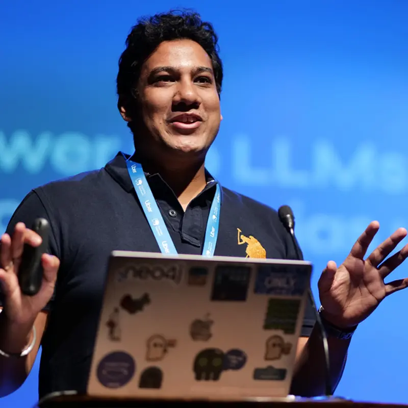
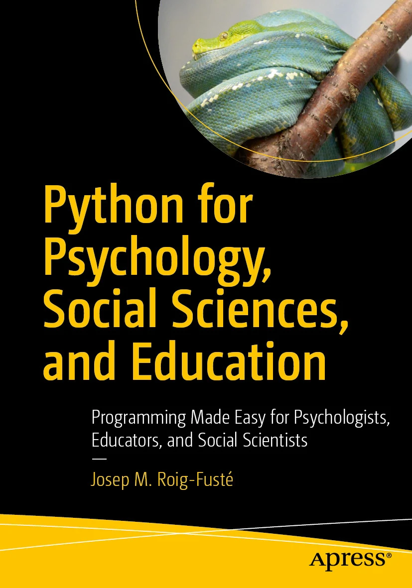
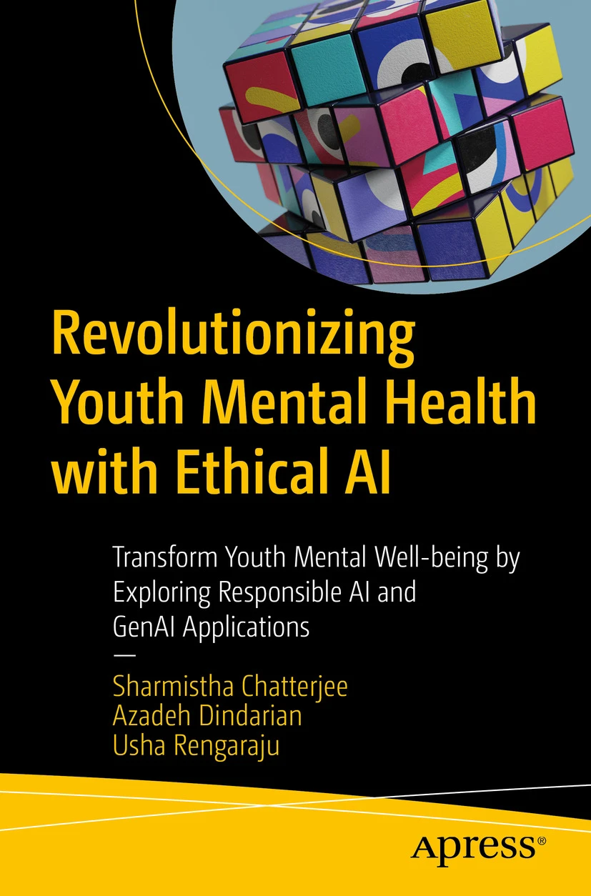
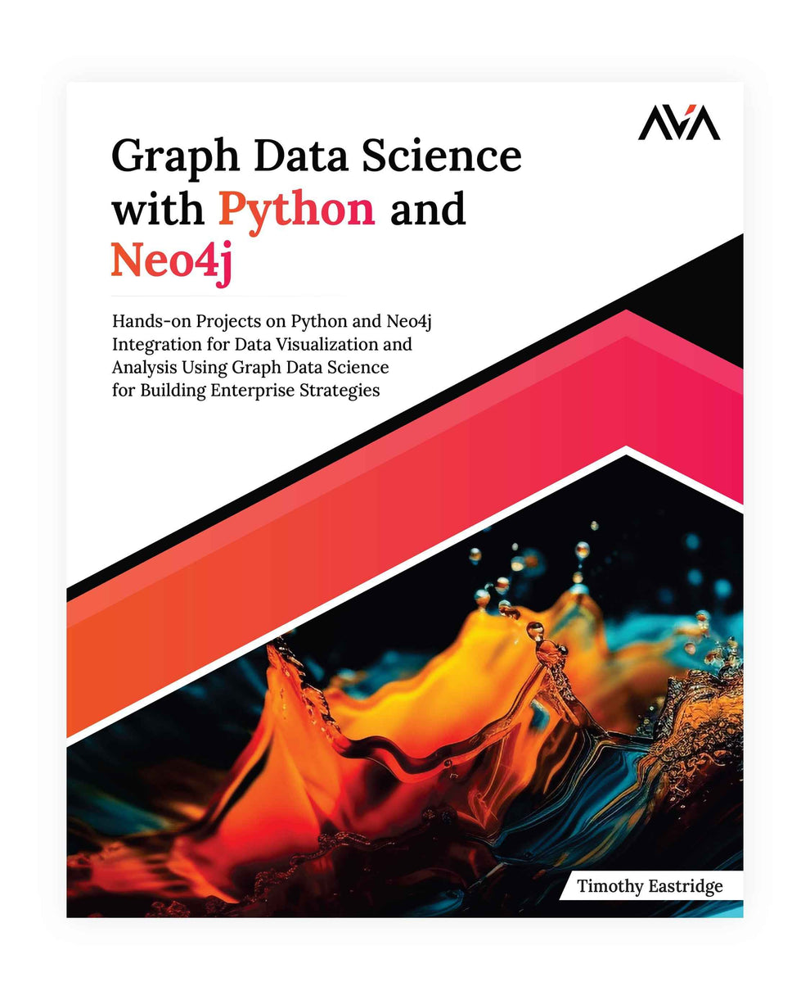

  
  <h1>Siddhant Agarwal</h1>
  
<strong>Telling tech tales &amp; shipping for builders.</strong>

  

    Senior Developer Relations Advocate, APJ at
    <a href="https://clickhouse.com">ClickHouse</a>
    · Bengaluru
  

  
<code>(Sid)-[:LOVES]-&gt;(:LEGO)</code>

  

    <a href="https://meetsid.dev"><strong>meetsid.dev</strong></a>
    &nbsp;·&nbsp;
    <a href="https://www.linkedin.com/in/sidagarwal04/">LinkedIn</a>
    &nbsp;·&nbsp;
    <a href="https://x.com/sidagarwal04">X</a>
    &nbsp;·&nbsp;
    <a href="https://www.youtube.com/@sidagarwal04">YouTube</a>
    &nbsp;·&nbsp;
    <a href="mailto:contact@meetsid.dev">contact@meetsid.dev</a>
  

I lead developer engagement across Asia-Pacific and Japan at [ClickHouse](https://clickhouse.com). The job is to make real-time analytics feel obvious to the people who build with it. The rest of the time I write, speak, and ship.

**Local to Global** is the whole method. A student community in a new city. A meetup that outgrows the room. An itch that becomes a product someone else needed too.

<table>
  <tr>
    <td align="center" width="25%"><strong>10+ yrs</strong> DevRel &amp; ecosystems</td>
    <td align="center" width="25%"><strong>9 / 12</strong> apps shipped in 2026</td>
    <td align="center" width="25%"><strong>4</strong> books &amp; reviews</td>
    <td align="center" width="25%"><strong>72</strong> talks on the record</td>
  </tr>
</table>

## Monthly Vibe Builds

Twelve months, twelve apps. Each one starts from a real itch, gets stripped to its core, and ships the same month. No PRD. No paywalls.

| | | |
|---|---|---|
| **10 · Oct** | [**Namma Mario**](https://namma-mario.netlify.app/) | A Bengaluru platformer. Church Street, Cubbon Park, Silk Board. Filter kaapi instead of Super Stars. |
| **08 · Aug** | [**Meridian**](https://meridian.meetsid.dev/) | Any journey, turned into a cinematic 3D globe or 2D map. |
| **07 · Jul** | [**Brewnchmark**](https://brewnchmark.netlify.app/) | A hackathon coffee-and-tea reveal, dressed as a SQL terminal. |
| **06 · Jun** | [**Soothr**](https://soothr.netlify.app/) | Offline white noise for 3 AM, built for one hand. |
| **05 · May** | [**OweNow**](https://owenow.netlify.app/) | Split a trip without becoming the group accountant. |
| **04 · Apr** | [**ShowFlix**](https://showflix-gd.netlify.app/) | Google Drive, browsed like a screening room. |
| **03 · Mar** | [**QRgen**](https://qrgen.meetsid.dev/) | Styled QR codes. No account, no paywall. |
| **02 · Feb** | [**SyncHorizon**](https://sync-horizon.netlify.app/) | Timezones, with daylight saving already handled. |
| **01 · Jan** | [**Currency Plus**](https://currency-plus.netlify.app/) | Every currency at once, updating as you type. |

The full year is at [meetsid.dev/mvb-2026](https://meetsid.dev/mvb-2026). Source for a few of them: [Meridian](https://github.com/sidagarwal04/meridian-app), [Soothr](https://github.com/sidagarwal04/soothr), [Currency Plus](https://github.com/sidagarwal04/currency_plus).

## Books

<table>
  <tr>
    <td width="220" valign="top">
      
    </td>
    <td valign="top">
      <h3>Building Neo4j-Powered Applications with LLMs</h3>
      
Author, with Ravindranatha Anthapu · Packt · June 2025

      
LLM-driven search and recommendations with Haystack, LangChain4j, and Spring AI. How to make a model answer from a graph instead of a guess.

      

        <a href="https://www.amazon.com/Building-Neo4j-Powered-Applications-LLMs-recommendations/dp/1836206232/"><strong>Amazon</strong></a>
        &nbsp;·&nbsp;
        <a href="https://www.packtpub.com/en-us/product/building-neo4j-powered-applications-with-llms-9781836206231">Packt</a>
        &nbsp;·&nbsp;
        <a href="https://www.oreilly.com/library/view/building-neo4j-powered-applications/9781836206231/">O'Reilly</a>
      

    </td>
  </tr>
</table>

Technical reviewer on three more:

<table>
  <tr>
    <td align="center" width="33%" valign="top">
      
       
      <strong>Python for Psychology, Social Sciences, and Education</strong> Apress · 2026
    </td>
    <td align="center" width="33%" valign="top">
      
       
      <strong>Revolutionizing Youth Mental Health with Ethical AI</strong> Apress · 2025
    </td>
    <td align="center" width="33%" valign="top">
      
       
      <strong>Graph Data Science with Python and Neo4j</strong> Orange AVA · 2024
    </td>
  </tr>
</table>

<a href="https://meetsid.dev/publications">All books on meetsid.dev →</a>

## Field notes

- [The Model Gets the Headlines. The Database Wins the Race.](https://medium.com/clickhousedb/the-model-gets-the-headlines-the-database-wins-the-race-3099160978cc) — why the model is the poster and the database is the result.
- [What a Developer Relations Career Actually Looks Like](https://blogs.polariscampus.com/blog/developer-relations-career) — a candid conversation with Polaris Tech Stories.
- [Polyglot Persistence — Not Just an Exotic Idea Anymore](https://www.dqindia.com/interview/polyglot-persistence-not-just-an-exotic-idea-anymore-11149790) — DataQuest, on specialized databases going mainstream.
- [DevRel Doesn't Scale by Accident](https://sidagarwal04.medium.com/devrel-doesnt-scale-by-accident-a-3-year-journey-building-apac-devrel-community-at-neo4j-21422d5cc2aa) — three and a half years building Neo4j across APAC.
- [Boundary Graph: the IPL, through a graph](https://medium.com/neo4j/boundary-graph-exploring-the-ipl-through-the-lens-of-graphs-bed4a5096447) — ball-by-ball cricket as a knowledge graph.

[Writing](https://meetsid.dev/blogs) · [Press](https://meetsid.dev/news)

## On stage

72 talks on real-time analytics, GraphRAG, generative AI, and what it actually takes to grow a developer ecosystem. Recordings are on [this playlist](https://www.youtube.com/playlist?list=PLSw4ttUqWj85SA4XfXP7jNPvOryy5PPPl). The full list, including what's next, is on [meetsid.dev/talks](https://meetsid.dev/talks).

## Selected code

| | |
|---|---|
| [**Boundary Graph**](https://github.com/sidagarwal04/boundary-graph) | IPL analytics on a Neo4j knowledge graph. Nuxt, FastAPI, ball by ball. |
| [**Mahabharata**](https://github.com/sidagarwal04/mahabharata-genai) | The epic, made queryable. A graph, plus a GenAI guide through it. |
| [**GraphRAG agents**](https://github.com/sidagarwal04/neo4j-adk-multiagents) | Multi-agent research with Google ADK, Neo4j, and MCP. |

Hands-on versions of the same ideas live as [codelabs](https://meetsid.dev/codelabs).

## The arc

A decade of ecosystems, in one place

 

**[ClickHouse](https://clickhouse.com)** — Senior Developer Relations Advocate, APJ · 2026–  
Community, advocacy, and technical storytelling for real-time analytics across Asia-Pacific and Japan.

**[Neo4j](https://neo4j.com)** — Developer Relations Lead, APAC · 2022–2026  
Nine chapters. A GenAI-first community motion. 165% meetup growth and 200%+ community growth, and the bridge between APAC developers and product.

**[Open Financial Technologies](https://open.money/)** — Lead, Developer Relations and Business Strategy · 2021–2022  
India's first developer community around fintech and embedded finance, built for Zwitch.

**[Google](https://developers.google.com/)** — Program Manager · 2019–2021  
270+ Developer Student Clubs across 120+ cities. Build for Digital India with MeitY. TensorFlow User Groups across the country.

Before that, ecosystem programs at Beahead, and the Java SDK at IBM.

## Working with

ClickHouse · SQL & real-time OLAP · Neo4j · GraphRAG · GenAI & agents · Python · LangChain · Haystack · Google Cloud · AWS · Azure · TypeScript

Former Google Developer Expert, AI/ML · ACM Distinguished Speaker · Neo4j Certified Professional · CMX Community Industry Awards, 2021 Global Finalist · Advisory Board, UPES School of Computer Science

---

  

    Speaking invitations, ecosystem collaborations, advisory, or a proper argument about databases.
     
    <a href="mailto:contact@meetsid.dev"><strong>contact@meetsid.dev</strong></a>
  

  
<em>Bridging local innovations to global opportunities.</em>

